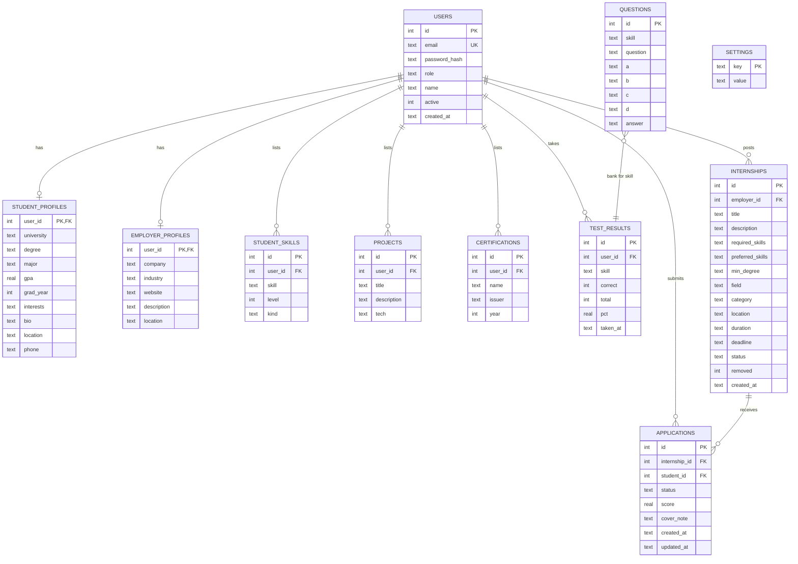

# Design Document — Database and UI/UX

## Part A. Database design

SQLite (file database, free). All foreign keys cascade on delete so removing a user removes their data.

### A.1 Entity-relationship diagram



### A.2 Key rules and constraints
| Rule | Enforced by |
|---|---|
| One account per email | `users.email UNIQUE` |
| Role is student, employer or admin | `CHECK (role IN ...)` |
| A student applies to an internship only once | `UNIQUE(internship_id, student_id)` |
| Application status is applied, shortlisted, accepted or rejected | `CHECK` constraint |
| A student has each skill once | `UNIQUE(user_id, skill)` |
| Deleting a user removes their profile, skills, tests, listings, applications | `ON DELETE CASCADE` |
| Admin removal of a listing is reversible | `internships.removed` flag |
| Fast lookups | indexes on `applications(student_id)`, `applications(internship_id)`, `test_results(user_id, skill)` |

### A.3 Matching data flow
1. Load the student's profile, skills, best test score per skill, projects, certificates.
2. Load the internship's required skills, preferred skills, degree, field, category.
3. Compute the five factor scores and combine them with weights 50/15/15/10/10 into a 0–100 score.
4. Show the score with matched skills, missing skills and the breakdown. A score is saved on the application when the student applies; employers always see a live recalculated score.

## Part B. UI/UX design

### B.1 Design principles
Clear next step on every page; the match score is always visible and explained; same layout on phone and desktop; accessible by keyboard and screen reader.

### B.2 Style guide
| Element | Choice |
|---|---|
| Framework | Bootstrap 5 grid and components (free, responsive) |
| Brand colour | Navy `#1e3a5f` header, cyan `#0dcaf0` accent |
| Score colours | 75%+ green, 55–74% blue, 35–54% orange, below 35% red (always paired with a number) |
| Status colours | Applied grey, Shortlisted blue, Accepted green, Rejected red (always paired with text) |
| Typography | System font stack, 16 px body |
| Accessibility | Labels on all fields, visible focus, skip link, ARIA labels on score rings and charts |
| Breakpoints | Phone under 576 px (single column, collapsed menu), tablet 768 px, desktop 992 px and up |

### B.3 Site map

```
Public:   Home · Sign up · Log in
Student:  Dashboard · Internships (ranked) → Internship detail → Apply
          Applications · Skill tests → Test → Result · My profile
Employer: Dashboard · Post internship · Company profile
          Listing → Candidates (ranked) → Candidate detail · Edit listing
Admin:    Overview (reports, institution report, objective tracking) · Users · Listings
All:      Change password · Log out
```

### B.4 Wireframes

**Student dashboard**
```
+------------------------------------------------------------+
| InternMatch  Dashboard Internships Applications Tests Profile  [Log out] |
+------------------------------------------------------------+
| Hi, Ayesha                                                  |
| [100% Profile] [7 Open] [0 Applications] [3 Skills tested]  |
| +----------------------------+ +-------------------------+ |
| | Top matches for you        | | Applications (chart)    | |
| | (84%) Backend Intern       | |  doughnut by status     | |
| | (69%) QA Automation Intern | +-------------------------+ |
| | (62%) Data Analyst Intern  | | Skill test performance  | |
| +----------------------------+ | Python  ████████ 88%    | |
|                                +-------------------------+ |
+------------------------------------------------------------+
```

**Internship detail with match**
```
+---------------------------------+ +-----------------------+
| Backend Developer Intern        | |  (84%) Excellent match |
| TechCorp · Lahore · 3 months    | |  Required skills  100% |
| Description ...                 | |  Education        100% |
| Required: [Python][SQL][Git]    | |  You have: Python ✓    |
| Preferred: [Docker][Flask]      | |  Missing: —            |
|                                 | |  [ Apply now ]         |
+---------------------------------+ +-----------------------+
```

**Employer candidates**
```
Backend Developer Intern      [Export CSV] [Dashboard]
Filter: [All][Applied][Shortlisted][Accepted][Rejected]
#1 (84%) Ayesha Rehman  [Shortlisted]   [status v][Set]
         Bachelor CS · FAST · GPA 3.6   Python✓ SQL✓ Git✓
#2 (61%) ...
```

**Mobile (375 px)**: menu collapses to a hamburger; cards stack; tables scroll inside their own container; buttons are full width.

### B.5 Key user flows
1. **Student:** Sign up → complete profile → take tests → open ranked internships → apply → track status.
2. **Employer:** Sign up → company profile → post internship → review ranked candidates → shortlist/accept/reject.
3. **Admin:** Log in → overview → deactivate user or remove listing → download institution report.

### B.6 Screens implemented
All wireframed screens are implemented in `templates/` (student, employer, admin folders). Charts use Chart.js; styles are in `static/style.css`.
